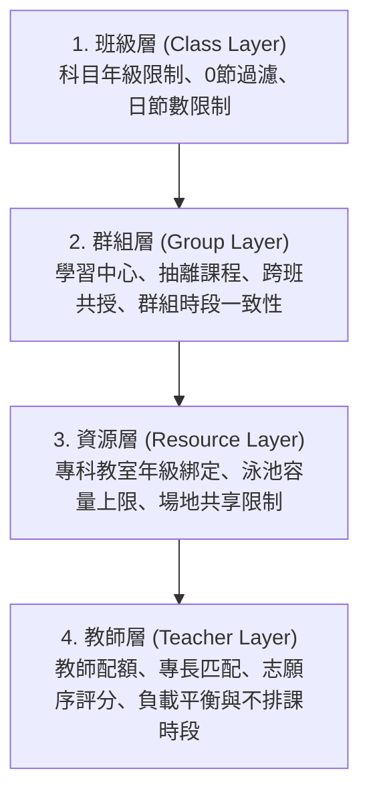

# 🏫 國小智慧排課系統 ( Primary School Smart Scheduling System)

國小智慧排課系統是一個專為國小排課場景（對應台灣 108 課綱）量身打造的校域級智慧排課與課表編排平台。本系統結合了現代前端技術、輕量後端資料庫，並以 Google OR-Tools CP-SAT 約束規劃求解器（Constraint Programming - Satisfiability）為核心，實現高效、精準、具備容錯與後處理能力的自動排課引擎。

> 本倉庫是公開版 / 開源版工作目錄。私人開發工作區中的本機資料庫、debug payload、診斷腳本、修復歷程與其他敏感檔案，不會同步到這裡。
> 公開版同步腳本只放在本倉庫，使用 `--source <私人來源資料夾>` 讀取來源內容；來源資料夾永遠只讀，只有 `F:\scheduler-public` 會被修改。

---

## 🛠️ 核心技術棧 (Technology Stack)

| 分層 | 技術技術 | 說明 |
| :--- | :--- | :--- |
| **前端 UI** | Vue 3 (Composition API) + Vite | 基於 `<script setup>` 語法開發，UI 元件採用 Element Plus |
| **狀態管理** | Pinia | 使用核心 `useScheduleStore` 進行資料庫雙向同步與引擎輪詢控制 |
| **後端 API** | Express.js (Node.js) | 作為 REST API 伺服器，並透過 `child_process.spawn` 橋接 Python 求解器 |
| **資料庫 & ORM** | SQLite + Prisma ORM | 本地輕量級資料儲存，使用 Prisma Client 驅動進行資料結構管理 |
| **排課引擎** | Python (OR-Tools CP-SAT) | 核心約規劃求解，使用滿意度約束求解器計算全校可行解 |
| **後處理優化** | Python (Simulated Annealing) | 實作專責優化代理 `repair_agent.py`（模擬退火演算法）微調課表與消除衝突 |
| **報表匯出** | XLSX (xlsx) / DOCX (docx) | 前端自動推導與生成教育部標準配課表、直式全校課表及專科教室課表 |

---

## 📂 專案目錄結構 (Directory Structure)

```
scheduler-frontend/
├── src/                          # Vue 3 前端專案程式碼
│   ├── components/               # 核心功能組件 (如 ProgressPanel, SubjectAssignmentForm)
│   ├── composables/              # 組合式邏輯 (如 useClassSync 班級同步, useTimetableConflicts 衝突檢測)
│   ├── stores/                   # Pinia 狀態管理 (schedule.js 核心資料儲存庫)
│   ├── utils/                    # 前端工具函式 (exportUtils 報表生成, alternatingHelper 交替課輔助)
│   ├── views/                    # 主要頁面視圖 (TimetableEditorView 全域預排畫布, ExportHubView 匯出中心)
│   ├── App.vue                   # 根元件
│   └── main.js                   # 應用入口
├── prisma/                       # Prisma 資料庫結構與設定
│   └── schema.prisma             # SQLite 資料庫 Model 定義
├── constraints/                  # Python 排課引擎約束規則模組
│   ├── base_rules.py             # 基礎常規約束
│   ├── class_rules.py            # 班級與年級習慣約束
│   ├── teacher_rules.py          # 教師與特教/抽離課程約束
│   └── special_rules.py          # 交替配對、專科教室指派與游泳課容量約束
├── docs/                         # 系統開發與中後期修復計畫文檔倉庫
├── server.js                     # Express API 伺服器 & Python 橋接主程式
├── solver.py                     # Python 智慧排課求解器主入口
├── phase2_engine.py              # 特殊/複雜科目（游泳、特教）的二階段求解引擎
├── preprocessor.py               # 資料預處理與正規化器
├── repair_agent.py               # 模擬退火（Simulated Annealing）課表後處理優化代理
├── diagnostic_stats.py           # 求解前/後資料品質與命中率統計診斷器
├── config.py                     # Python 引擎全域常數與科目代碼配置
├── utils.py                      # Python 工具函數與 JSON 解析器
├── dev.db                        # 本地 SQLite 資料庫檔案
├── package.json                  # Node.js 套件依賴與腳本定義
└── DataDictionary_2.md          # 系統資料字典與最新架構手冊
```

---

## 🧠 智慧排課引擎：四層核心模型 (Core Model Layers)

為了忠實還原國小現場的複雜排課規則，排課引擎被設計為具備**四個語義層次**的約束模型：



1. **班級層**：界定每年級特有的科目範疇與節數需求（例如 1-2 年級生活課程，3-6 年級自然、社會與專科課），自動排除需求為 `0 節` 的指派，防範班級無課或超排。
2. **群組層**：處理特教/學習中心等**抽離課程**。確保多個被抽離的班級在指定時段被強排在同一個目標科目，特教教師的抽離課變數與常規課變數互斥並防衝堂。
3. **資源層**：管理空間瓶頸，包括**專科教室的年級綁定指派**（如六年級自然教室專屬、四五年級共享，建立精準的 `assign_c_r_p` 教室指派變數）及**游泳池的每時段班級容量上限限制**（上限 3 班）。
4. **教師層**：包含教師專長對齊、教師個人減課/超鐘點的動態配額運算、年級填報志願序與負載平衡雙軌排序，以及個人不可排課時段硬性屏蔽。

---

## 🚀 專案修復與中後期優化歷程 (Major Repair Trajectory)

本專案在中後期經歷了數次核心修補計畫，旨在解決因「局部規則全局化」或「模型顆粒度失真」引起的 `INFEASIBLE`（無解）問題，逐步逼近真實課表的可行形態：

### 1. 全域預排畫布與單格時段鎖定 (Manual Locking)
* **修復背景**：為支持現場排課人員的經驗調整，系統需提供「手動預排」並能在後續自動求解中被保護。
* **解決方案**：在 `TimetableEditorView` 新增了單格時段鎖定/解鎖功能，對應資料庫中 `CourseRequirement` 表的 `isLocked` 標記。Solver 在建立變量時，若偵測到 `isLocked = true`，會強制將該時段對應的 BoolVar 設為 1，從而保護手動預排結果。

### 2. 求解器分拆與模組化重構 (Solver Py Modularization)
* **修復背景**：早期的 `solver.py` 膨脹至數千行，約束交叉耦合，難以維護與除錯。
* **解決方案**：將求解器進行重構，拆分出獨立的 `constraints` 資料夾：
  * `base_rules.py` 承載硬性重疊與時段邊界。
  * `class_rules.py` 管理班級節數。
  * `teacher_rules.py` 維護教師專長與特教抽離。
  * `special_rules.py` 處理交替、專科教室與游泳池等重壓資源。

### 3. 學習中心與抽離課程群組化建模 (Learning Center & Pull-out Groups)
* **修復背景**：原系統將抽離課拆成各班獨立的常規課程處理，遺失了「多班共授、特教老師協同」的群組結構，導致抽離時間分散且科目無法同步。
* **解決方案**：引進**群組聚合機制**。系統根據群組特徵（名稱、科目、教師）將抽離課規則群組化，在時段分配上建立群組時段變數 `sc_vars`，並自動同步被抽離班級的目標科目。特教課時段也計入特教教師的工作負載，防止超載與衝突。

### 4. 泛型交替科目與軟約束配對 (Generic Alternating & Soft Pairing Fallback)
* **修復背景**：系統原僅硬編碼支援 `音樂美勞` 完美交替，且因過度全局化，若出現奇數班級組成的教師配對群組（Odd Cycle/Pigeonhole），在數學上將會無解，直接引發 `INFEASIBLE`。
* **解決方案**：
  * 支持泛型 `/` 分割科目的自動識別（如 `健/s` 健體、`s/社` 綜合社會），動態生成單雙週變數。
  * 引入**自動防禦降級機制**：針對班級數為奇數的群組或在設定中指定為軟約束的年級，自動將互補配對由硬限制降級為**軟約束**，當發生單雙週方向相同（mismatch）時施加罰分，保證求解器 100% 產出可行解。

### 5. 專科教室年級親和力與指派決策模型 (Grade-bound Classroom Assignment)
* **修復背景**：舊模型將專科教室視為「單一學科容量池」，無視「六年級自然教室」、「英語五年級教室」等現場固有的年級專屬性，造成六年級班級被錯塞到三年級教室等物理上不可落實的狀況。
* **解決方案**：
  * 廢除全局總量估算，為各班級與教室建立明確的 `assign_c_r_p` 指派變數。
  * 實作年級硬性相容過濾（`allowSharing = false` 時非優先年級不可使用）。
  * 實作軟性懲罰機制：非優先年級共享（`GRADE_AFFINITY_MISS_PENALTY = 400`）與非主責教師使用（`PRIMARY_TEACHER_MISS_PENALTY = 800`）會被疊加懲罰，引導求解器將資源合理歸位。
  * 加入虛擬教室防護網（Fallback），防範核心科目未建檔專科教室時引發排課坍塌。

### 6. 游泳課泳池容量精準排除 (Swimming Lesson Capacity Correction)
* **修復背景**：原系統在計算泳池容量時，將一般體育課也無條件計入，導致每班每週佔用 3 節泳池（2節游泳連堂+1節常規體育）。全校 33 個班共需 99 個泳池節數，而泳池物理極限僅 84 個，造成系統無條件 `INFEASIBLE`。
* **解決方案**：修正在 `constraints/special_rules.py` 中建立 `pool_active` 變數的篩選邏輯，**移除體育課的無條件累加**，僅在排定為游泳連堂的時段才計入泳池容量，常規體育課回歸常規操場，順利將總需求降至 66 班·節（$\le 84$ 容載極限），成功解鎖物理死結。

### 7. 科任教師智慧自動配課演算法 v2 (Smart Subject Assignment v2)
* **修復背景**：早期科任配課介面在點擊自動分配時，未過濾 0 節科目、忽略學科年級限制（如自然、音樂、美勞只應開設在 3-6 年級），且無法根據教師志願排序，導致分配紊亂。
* **解決方案**：在 `SubjectAssignmentForm.vue` 重構智慧分配邏輯：
  * 自動忽略 `periods <= 0` 的需求。
  * 鎖定「自然」、「科學」、「音樂」、「美勞」等科目僅指派至 3-6 年級班級。
  * 引入**雙軌排序演算法**：優先度按「志願序（第一志願 > 第二志願 > ... > 無志願）」進行排序，同志願級別則分派給目前已被指派節數最少（負載最輕）的教師，最後輔以教師姓名進行 Tie-breaker 排序，保障配課結果的穩定性。

### 8. 報表匯出轉型與多格式支援 (Export Hub Formats & DOCX)
* **修復背景**：學校在排課完成後，需要導出符合多方視角的報表，包括教師彙總表、全校課表（含單雙週標記）及以專科教室為視角的課表。
* **解決方案**：在 `ExportHubView.vue` 與 `exportUtils.js` 中支援三種格式匯出：
  * **教育部標準格式 (XLSX)**：扁平化匯出教師配課彙總表。
  * **全校班級課表 (XLSX)**：5天×7節的班級矩陣課表，自動推導並標記交替課符號（`*` 單週, `#` 雙週）。
  * **專科教室課表 (DOCX)**：以教室/空間為中心的課表，包含上午、午休及整理時段。

### 9. 求解器解空間解鎖與模擬退火優化代理 (INFEASIBLE Unlocking & Simulated Annealing)
* **修復背景**：當排課需求遭遇極端物理死結（如專科教室容量極度緊繃、多種配對衝突）時，硬約束求解器會直接回報 `INFEASIBLE`（無解）。
* **解決方案**：
  * 將專科教室容量限制由硬約束改為帶高罰分的軟約束，以確保求解器能在任何死結時都 100% 產出可行解。
  * 引入 `repair_agent.py`（模擬退火優化代理）與 `diagnostic_stats.py`（診斷統計模組），在 Python CP-SAT 求解後自動進行後處理微調，消除軟性容量超載並極大化教師專長與年級優先度之命中率。

### 10. 專科教室具體指派結果導出與衝堂持久化 (Classroom Assignment & Conflict Persistence)
* **修復背景**：先前求解器雖然建立了教室指派變數（`assign_c_r_p`），但其決策解在輸出時被直接拋棄，前端只能以模糊反推粗暴瞎猜；且全域衝突資訊只能在前端運行時暫存，無法保存供未來 AI 儲存與分析。
* **解決方案**：
  * 擴充 Prisma schema 的 `Class` 模型，新增 `conflicts` 欄位以儲存衝堂資訊 JSON 字串。
  * 後端求解器將專科教室指派決策作為 `classroomName` 寫入課表項目的輸出欄位；前端在儲存時，會自動透過 `useTimetableConflicts.js` 計算出最新的衝堂明細並序列化同步至資料庫。
  * 前端 `TimetableEditorView` 精簡格子衝突標籤為「⚠️ 衝堂」，並在下方新增「🚨 課表衝堂詳細說明」面板展示具體衝突細節（空間、人物、時間）。

### 11. 交替課程教室對齊與共享專科教室報表支援 (Alternating Subject Room Mapping & Shared Room Export)
* **修復背景**：前端在繪製專科教室課表時因缺乏具體對應欄位，使用科目名稱作模糊匹配，但在遇到音樂與美勞交替課（其科目名稱在排課後變為 `"音樂(單)/美勞(雙)"`）時，因與單一科目名 `"音樂"` 不等而完全失效，且完全共享（無 primaryTeacher）的教室會被報表中心直接過濾排除。
* **解決方案**：
  * 重構 `ClassroomManagerView` 教室分流邏輯，優先採用精確的 `classroomName` 匹配，並引入防禦性向下相容設計，無指派時回退至模糊反推。
  * 在 `exportUtils.js` 中將原先的科目精確匹配放寬為包含式匹配（`cell.subject.includes(room.subject)`），確保交替課即使在手動預排時亦能成功對齊教室。
  * 放寬報表中心的專科教室匯出條件，允許無主責教師的共享教室產出課表，且負責教師部分自動呈現為「共享」。

### 12. 導師科目自動區塊化與 CP-SAT 約束降載 (Homeroom Blockization & Solver Offloading)
* **修復背景**：先前在系統設定勾選了「導師科目自動區塊化」後，因後端未讀取該設定，也未在預處理時對國語、數學、社會等導師自授普通課執行吞併，使得課表上印滿了被 AI 排死的普通科目，且給求解器造成極大運算負擔。
* **解決方案**：
  * 後端 `solver.py` 串接並傳遞前端 `aiSettings` Payload 至 `preprocess_classes` 函數。
  * 修改 `preprocessor.py` 中的 `_homeroom_blockization`，在啟用該功能時，遍歷並加總所有非生活、非游泳、非體育的導師普通學科，將其吞併合併為名為「導師區塊」的單一條目以大伏減少 OR-Tools 限制網絡的規模，降載求解器，並把剩餘的普通科目留存於前端背包，以保留大片灰色空白時段給導師手動微調。

---

## 🏃‍♂️ 本地開發與部署指引 (Installation & Startup)

### 先決條件

這個專案可以在 Windows 與 Ubuntu 上執行，但有兩個原則很重要：

1. `node_modules` 和 `venv` 不能跨作業系統共用。
2. 每次換平台或重裝環境時，都要在當下那台機器重新 `npm install` 與建立 Python 虛擬環境。

建議版本：

| 元件 | 建議版本 |
| :--- | :--- |
| Node.js | `20.19.0` 以上，或 `22.12.0` 以上 |
| npm | 隨 Node.js 一起安裝 |
| Python | `3.9+` |
| 作業系統 | Windows 10/11 64-bit 或 Ubuntu 24.04+ |

### Windows 安裝步驟

1. 安裝 Node.js 20.19+ 或 22.12+。
2. 安裝 Python 3.9+，並確認 PowerShell 可以執行 `python --version`。
3. 在專案根目錄執行：
```powershell
npm install
python -m venv venv
.\venv\Scripts\Activate.ps1
pip install ortools numpy pandas
npx prisma db push
```
4. 啟動後端：
```powershell
node server.js
```
5. 開啟另一個終端機啟動前端：
```powershell
npm run dev
```
6. 瀏覽器開啟 `http://localhost:5173`。

### Ubuntu 安裝步驟

1. 安裝 Node.js 20.19+ 或 22.12+。
   - 如果系統套件庫版本太舊，請改用官方安裝方式或 `nvm`。
2. 安裝 Python 與 venv 工具：
```bash
sudo apt update
sudo apt install -y python3 python3-venv python3-pip
```
3. 在專案根目錄執行：
```bash
npm install
python3 -m venv venv
source venv/bin/activate
pip install ortools numpy pandas
npx prisma db push
```
4. 啟動後端：
```bash
node server.js
```
5. 開啟另一個終端機啟動前端：
```bash
npm run dev
```
6. 瀏覽器開啟 `http://localhost:5173`。

### 常見問題

* 如果出現 `Cannot find native binding`，通常是把別的作業系統建立的 `node_modules` 複製過來了。請刪除 `node_modules` 後在當下系統重新 `npm install`。
* 如果 Python 找不到，請確認 `server.js` 會優先尋找專案內的 `venv`；若要用系統 Python，請先確認 `python` 或 `python3` 可直接執行。
* 如果你曾在 Windows 與 Ubuntu 之間切換開發，建議同時刪除 `node_modules` 與 `venv`，再重新安裝一次。
